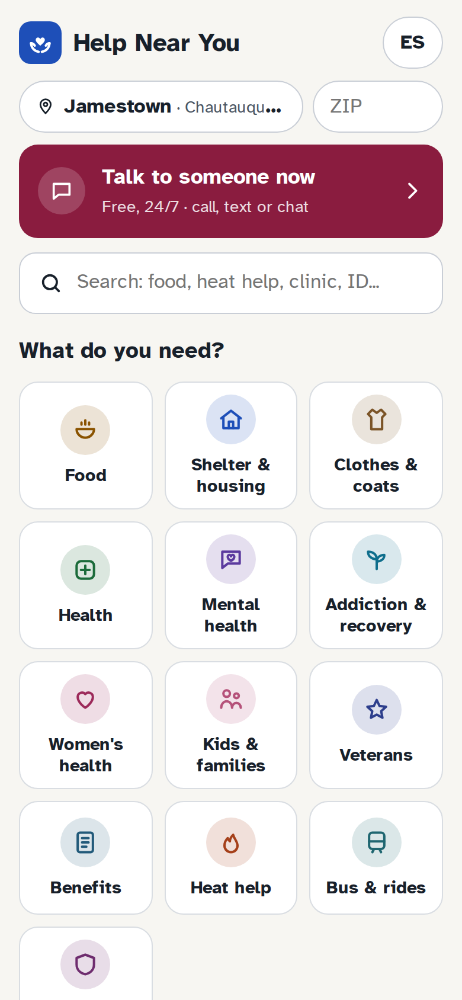
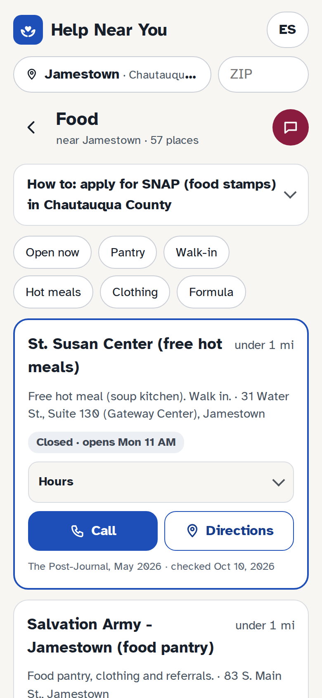
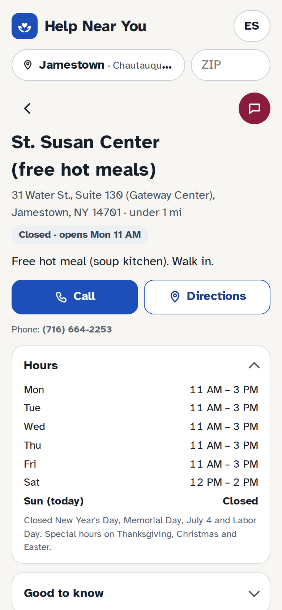
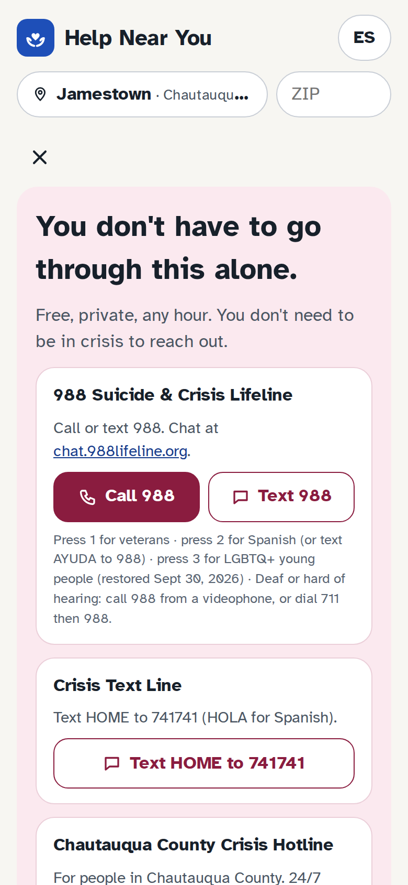
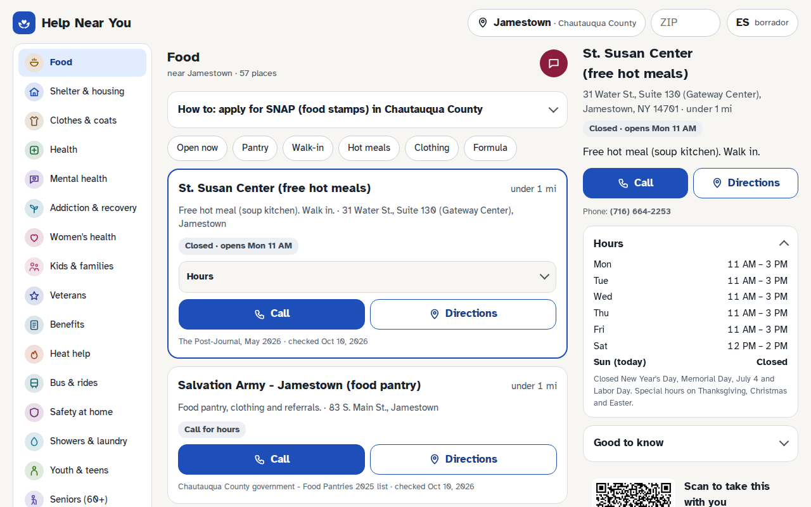

<p align="center"></p>

<h1 align="center">Help Near You</h1>

<p align="center"><b>Free help near you in New York State.</b><br>
Food, a place to stay, clothes and coats, health care, someone to talk to, benefits, heat help, rides and more,<br>
on any phone, with nothing to sign up for and nothing tracked.</p>

<p align="center"><a href="https://helpnearyou.org"><b>helpnearyou.org</b></a> · <a href="https://helpnearyou.org/about.html">About &amp; privacy</a></p>

<p align="center">




</p>

> **In danger right now? Call 911.** Need to talk? Call or text **988**, any hour. No smartphone? Call **211**.

## What it does
- **1,397 places across New York State**, with Western New York (Chautauqua, Erie, Niagara, Cattaraugus, Allegany) covered in depth. Every county has at least its main public offices and crisis line.
- **Sorted by distance** from your ZIP code, your town, or your phone's location. The location stays on the phone.
- **Open now** badges and full weekly hours, with "call first" on anything not double-checked yet.
- **24 kinds of help:** food, shelter, clothes and coats, health, mental health, addiction and recovery, women's health, kids and families, veterans, benefits, heat help, bus and rides, safety at home, showers and laundry, youth, seniors, dental and eyes, ID, legal help, libraries and Wi-Fi, jobs, after jail or prison, and LGBTQ+.
- **Talk to someone now** on every screen: 988, the Crisis Text Line, the county's own crisis line, and lines for veterans, LGBTQ+ youth, new moms, and drugs or alcohol.
- **Safety at home** with a Quick exit button. Domestic violence shelter addresses are never stored or shown.
- **Step-by-step guides** for SNAP, HEAP heating help, Medicaid, a place to sleep tonight, and replacing ID.
- **Works offline** once opened, and can be added to the home screen like an app.
- **A QR code on every place**, so a worker can hand the details to someone's phone, even with no signal.
- **Spanish** (a draft, waiting for a native speaker to check it).

<p align="center"></p>

## How it stays up to date
Twice a day, about 6 AM and 10 PM New York time, [a GitHub Action](.github/workflows/update.yml) runs `update.py`:

1. applies confirmed changes from [`corrections/`](corrections/README.md), which usually come from phone calls;
2. checks every listing's source web page, and puts any place whose page disappeared or changed on [`status/to-check.md`](status/) for a person to call;
3. marks anything not checked in 6 months as "call first";
4. rebuilds the site and publishes it here on GitHub Pages.

Nothing is changed on a guess: a person confirms first.

## Know a place that's wrong or missing?
Use **"Something wrong? Tell us"** on the listing in the app, or [open an issue](../../issues/new/choose).

## Run it yourself
```
python3 build.py      # writes site/ (the website) and hny.html (a single-file copy)
python3 update.py     # the twice-a-day update, by hand (add --no-web to skip the web checks)
```
Python 3 only, no other installs. Setting up hosting is in [SETUP.md](SETUP.md).

| File | What it is |
|---|---|
| `data.json` | Every listing (name, phone, hours, source, date checked) plus New York ZIP codes and towns |
| `template.html` | The app (one page, plain JavaScript, no framework) |
| `about.html` | About & privacy page |
| `build.py`, `update.py` | Build and twice-a-day update |
| `corrections/` | Confirmed changes |
| `print/` | Posters (letter with tear-off tabs, restroom half-sheet) and wallet cards with QR codes |
| `vendor/` | QR library (MIT), Atkinson Hyperlegible font (SIL OFL), icons |

## Ground rules for the data
- Domestic violence shelter addresses are never stored or shown: phone and hotline only.
- Every listing names its source and the date it was checked.
- No place pays to be listed. Help Near You isn't connected to any government agency.
- It's a guide, not an emergency service, and not legal or medical advice.

---
Made by Lucas R. in Western New York. Place data: GeoNames (CC BY 4.0). Listings: the public sources named on each one.
